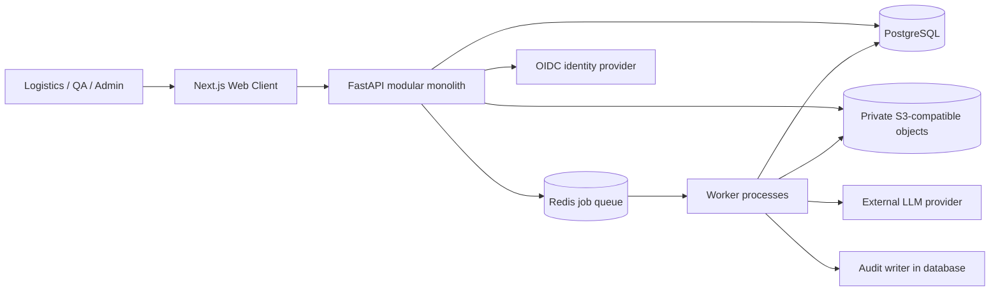
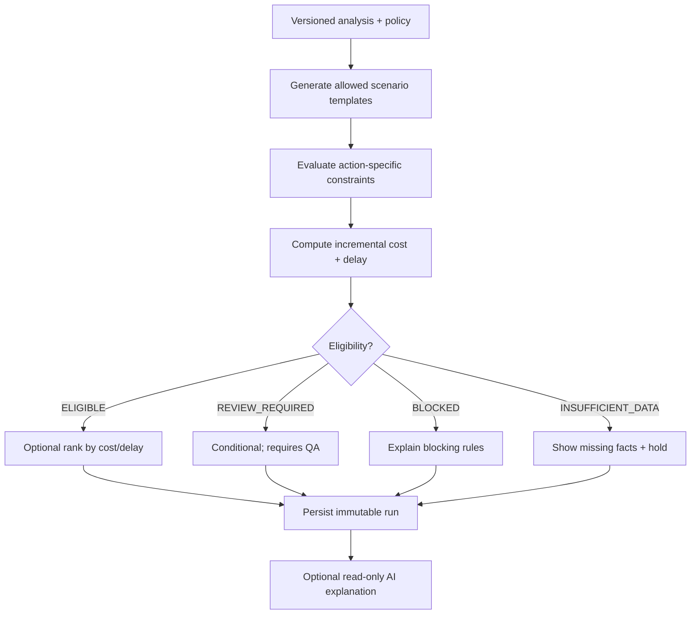
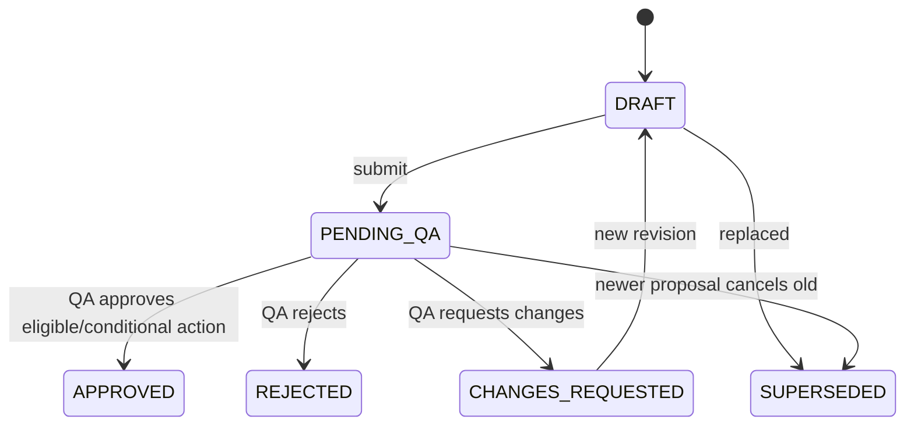
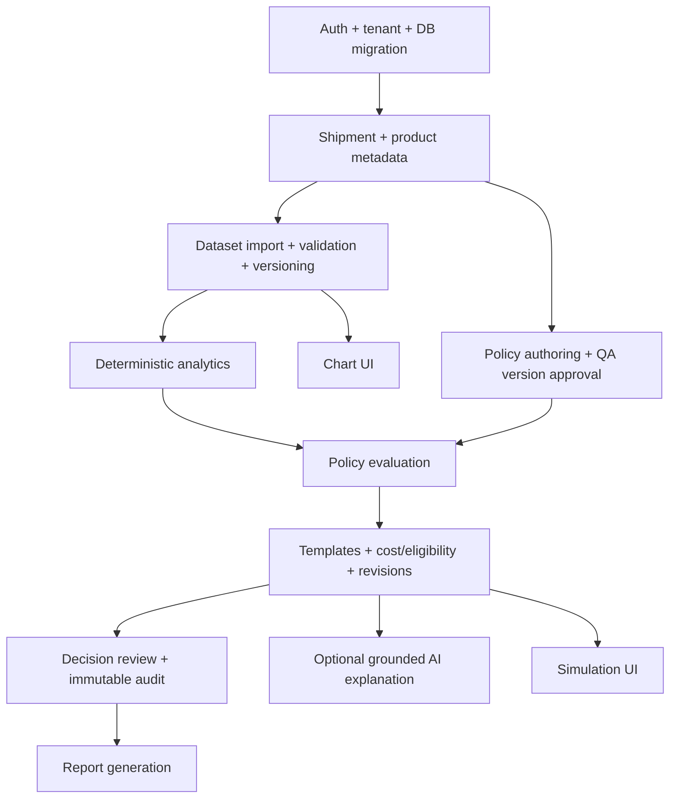

# ARCHITECTUR.md — System Architecture & Technical Design

**Product:** Cold Chain Decision Intelligence Platform (Transport Simulation)  
**Scope:** MVP v1.0 | **Document version:** 1.0.0 | **Status:** Proposed / Sprint-0 review  
**Date:** 2026-11-11 | **Source of truth:** `Cold_Chain_Decision_Intelligence_PRD_MVP_v1.0.md`  
**Companion:** `API.md`

> This document defines the proposed implementable architecture. It is not a food-safety certification, and no numeric example herein is an approved product-specific threshold. The PRD controls product scope; this document describes technical realization. Record deviations in ADRs before implementation.

## 1. Goals and non-goals

### Goals
1. Provide a reproducible **CSV → validated dataset → excursion analysis → policy evaluation → scenarios → QA-reviewed decision → report** workflow.
2. Maintain strict organization isolation, immutable evidence and version-pinned calculations.
3. Keep all eligibility and cost logic deterministic, independently testable and usable without AI.
4. Let AI explain verified outputs without becoming a safety authority.
5. Deliver an operationally simple modular monolith, with clear boundaries for future extraction.

### Non-goals in MVP
Live IoT ingestion, live GPS/traffic optimization, autonomously issuing transport commands, predictive validated shelf-life models, cross-currency financial conversion, ERP/TMS integration, autonomous product release, and general multi-commodity safety inference.

### Guiding invariants
- **Safety before optimization:** `HARD_BLOCK` cannot be traded against price/time or overridden through normal QA approval.
- **Unknown is not safe:** missing data, unapproved policy, ambiguous sensors, or missing receiver permission cannot become `ELIGIBLE` by default.
- **Snapshot integrity:** submitted decisions reference exact versions/hashes of inputs and outputs; prior runs never change after re-upload/recalculation.
- **Tenant isolation:** every cross-entity access verifies tenant consistency, server-side.
- **LLM non-authority:** no LLM path changes rules, scores, eligibility, shipment state or approval status.
- **QA approval is an internal review record, not formal certification of food safety.**

## 2. Design decisions (Sprint 0 baseline)

| ID | Topic | Proposed selection | Rationale / condition |
|---|---|---|---|
| ADR-001 | Application shape | Modular monolith | Transactional boundaries, simpler deployment |
| ADR-002 | Frontend | Next.js + TypeScript + Tailwind + shadcn/ui + ECharts | Typed UI, rich time-series visualization |
| ADR-003 | Backend | Python + FastAPI + Pydantic v2 | Strong validation and Python analytics ecosystem |
| ADR-004 | Persistence | PostgreSQL + SQLAlchemy + Alembic | Relational integrity and versioned records |
| ADR-005 | CSV/raw reports | S3-compatible private object storage | Immutable original files and report artifacts |
| ADR-006 | Background execution | Redis + RQ (initial choice) | Lightweight, bounded CSV/AI/report jobs |
| ADR-007 | Authentication | OIDC provider + backend session (BFF-friendly) | Avoid custom password systems where possible |
| ADR-008 | Authorization | Tenant-scoped RBAC in backend | QA distinct from Admin, least privilege |
| ADR-009 | AI | Provider-agnostic adapter, schema-validated, opt-in | Graceful fallback and no provider lock-in |
| ADR-010 | Operations | Docker Compose for MVP environments | Fast initial delivery; production hardening required |
| ADR-011 | API | REST `/api/v1`, JSON, OpenAPI 3.1 | Contract-first client/server development |
| ADR-012 | Money/time | `NUMERIC` decimal minor-unit-aware, ISO 8601 UTC | Avoid float/currency rounding and timezone drift |

**Open before production:** identity provider, data residency/AI-processing contracts, retention periods, evidence/legal requirements, approved strawberry policy, actual load benchmark machine, RPO/RTO, operational SLAs, and whether reviewers may approve their own proposals. Defaults below are proposals, not confirmed customer requirements.

## 3. Context and containers



Trust boundaries: browser is untrusted; uploads are untrusted; OIDC tokens must be verified; LLM output is untrusted; database/object storage are private. UI never connects directly to DB/Redis. Signed upload/download URLs must be short-lived, tenant-authorized and restricted by object key prefix and content type.

### Runtime modules and ownership

| Module | Responsibilities | May depend on | Must not do |
|---|---|---|---|
| `identity` | Session, OIDC, memberships, RBAC | DB | Approve QA policies merely because user is Admin |
| `shipments` | Shipment metadata and lifecycle | identity, products | Infer product safety |
| `temperature` | File intake, schema mapping, parsing, provenance | shipments, storage, jobs | Silently correct invalid measurements |
| `analytics` | Time intervals, gaps, excursion events | temperature, policies | Use AI to calculate excursions |
| `products` | Product catalog | identity | Set unspecified validated limits |
| `policies` | Rule schema, approval, effective ranges, evaluation | products, identity | Execute user-supplied Python or arbitrary expressions |
| `simulations` | Template generation, eligibility, cost/time ranking | analytics, policies, shipments | Rank blocked/unknown cases as executable |
| `decisions` | Proposal and QA workflow | simulations, identity, audit | Issue real-world vehicle/product commands |
| `ai` | Grounded explanation summaries | persisted evaluation read-model | Modify core evaluation results |
| `reports` | Immutable PDF exports | decisions, object storage | Regenerate evidence against newest policies |
| `audit` | Append-only business/security events | DB | Store raw credentials or unneeded personal data |

**Dependency rule:** transport/API adapters call application services; application services call deterministic domain functions and repositories; domain functions never import FastAPI, ORM or provider SDKs.

## 4. Logical layers and repository structure

```text
repo/
  apps/web/                      # Next.js pages, components, hooks, generated API client
  services/api/
    app/
      api/v1/                    # route adapters and exception mapping
      core/                      # config, auth context, errors, pagination
      identity/ shipments/ products/ policies/
      temperature/ analytics/ simulations/
      decisions/ ai/ reports/ audit/
      db/                        # connection, migrations, repositories
      jobs/                      # RQ entry points and idempotent handlers
    tests/{unit,integration,contract,e2e}/
  packages/contracts/            # generated OpenAPI spec/client/models
  docs/{PRD.md,ARCHITECTUR.md,API.md,adr/}
  infrastructure/{compose,nginx,monitoring}/
  fixtures/{csv,policies,expected_outputs}/
```

Every module has `domain.py` (pure logic), `schemas.py`, `service.py`, `repository.py`, and optional `jobs.py`. Keep tests next to or under module tests. OpenAPI is generated from FastAPI and snapshot-diffed in CI; `API.md` is the human contract and changes must be reflected both ways.

## 5. Persistence and relational design

**Conventions:** UUID PKs; `organization_id` on every tenant-owned table, immutable `created_at` UTC, `updated_at` where mutable; unique constraints scoped by tenant; `DECIMAL/NUMERIC` for monetary values; indexed `(organization_id, ...)`; FK enforcement including composite tenant-consistency where practical. Do not trust `organization_id` from a client body. Resolve tenant from authenticated context.

### Core schema (logical)

| Table | Core columns / essential constraints |
|---|---|
| `organizations` | `id, name, status, created_at` |
| `users` | `id, identity_subject UNIQUE, email, name, status` |
| `organization_memberships` | `organization_id, user_id, roles TEXT[], status`; unique `(organization_id,user_id)` |
| `products` | `id, organization_id, name, category, packaging_type, active`; unique `(organization_id,id)` |
| `quality_policy_versions` | `id, organization_id, product_id, policy_key, version, status, rules_jsonb, rule_schema_version, effective_from, effective_to, reference_document_id, approved_by, approved_at, content_sha256`; unique `(organization_id,policy_key,version)` |
| `shipments` | `id, organization_id, reference, product_id, origin, destination, departure_at, estimated_arrival_at, status, cargo_value NUMERIC(18,2), currency CHAR(3), revision`; unique `(organization_id,reference)` |
| `temperature_datasets` | `id, organization_id, shipment_id, version, raw_object_key, sha256, mapping_jsonb, source_timezone, status, row_count, uploaded_by, created_at`; unique `(organization_id,shipment_id,version)` |
| `temperature_readings` | `id, organization_id, dataset_id, sensor_id, timestamp_utc, temperature_c NUMERIC(8,3), quality_flag, source_row`; index `(organization_id,dataset_id,sensor_id,timestamp_utc)` |
| `analysis_runs` | `id, organization_id, shipment_id, dataset_id, policy_version_id, engine_version, status, summary_jsonb, input_sha256, created_at` |
| `excursion_events` | `id, organization_id, analysis_run_id, sensor_id, start_at, end_at, duration_seconds, min_c, max_c, rule_id, classification` |
| `simulation_runs` | `id, organization_id, shipment_id, analysis_run_id, dataset_id, policy_version_id, engine_version, template_version, status, assumptions_jsonb, input_sha256, created_by, parent_run_id, created_at` |
| `simulation_scenarios` | `id, organization_id, simulation_run_id, type, eligibility, costs_jsonb, delay_minutes, risk_classification, evaluation_jsonb, ranking_score` |
| `ai_explanations` | `id, organization_id, simulation_run_id, model, prompt_version, schema_version, source_digest, content_jsonb, status, created_at` |
| `decisions` | `id, organization_id, simulation_run_id, scenario_id, status, justification, snapshot_jsonb, snapshot_sha256, submitted_by, submitted_at, reviewed_by, reviewed_at, review_notes, revision, created_at` |
| `reports` | `id, organization_id, decision_id, decision_snapshot_sha256, object_key, report_sha256, status, created_at` |
| `audit_logs` | `id, organization_id, actor_id, acting_role, action, entity_type, entity_id, before_digest, after_digest, metadata_jsonb, request_id, created_at` |
| `jobs` | `id, organization_id, type, resource_id, status, attempt_count, result_jsonb, error_code, created_at, finished_at` |
| `idempotency_records` | `organization_id, actor_id, route_key, idempotency_key, request_hash, response_status, response_json, expires_at`; unique scoped key |

**Note:** `source_row` and raw file preserve original input; normalized readings can be re-derived. `quality_policy_versions` uses single version rows, not mutable policy JSON overwritten in place. Use enum-like CHECK constraints for statuses, positivity checks for costs/durations where applicable, and preserve the original decimals on input.

### Immutability rules
- Raw uploaded objects: content-addressed key (`tenant/dataset/sha256`) with write-once policy where available; immutable dataset versions and source checksums.
- APPROVED/RETIRED policy bodies: non-editable; create a new DRAFT version for changes.
- COMPLETE analysis and simulation: results append-only; recalculation creates `parent_run_id` reference.
- Submitted decision: immutable snapshot; status/review metadata changes via restricted audited transitions, not in-place evidence rewriting.
- Audit logs: append-only at application layer, least privilege DB account; consider DB triggers/WORM storage for regulated deployment.

## 6. Ingestion pipeline

```mermaid
sequenceDiagram
  participant U as Browser
  participant A as API
  participant O as Object Storage
  participant Q as Queue/Worker
  participant D as Database
  U->>A: POST dataset multipart + mapping + timezone
  A->>A: auth, tenant, size/content checks
  A->>O: store private original object + SHA-256
  A->>D: create immutable dataset vN (QUEUED) and job
  A-->>U: 202 Accepted + dataset/job IDs
  A->>Q: enqueue committed job ID
  Q->>O: read original file
  Q->>Q: virus/file validation; parse; normalize; validate rows
  Q->>D: transactional readings and validation result
  Q-->>D: job + dataset READY / FAILED
  U->>A: poll GET dataset validation/job status
  A-->>U: count, row errors, warnings, version
```

### Parsing policy
- MVP accepts UTF-8 CSV (optional BOM); reject malformed encoding, executable/binary masquerading as CSV, excessive lines/cells and formula-like cells when exporting (CSV injection defense).
- Required timestamp and temperature; sensor ID defaults to a single known sensor only when uploader confirms the mapping. Mixed units require per-row unit; no guessing.
- Naive timestamps require explicit IANA timezone; reject ambiguous or nonexistent DST local times unless disambiguated. Persist original text and normalized UTC.
- Normalize Fahrenheit via `(F−32)×5/9` using Decimal; persist Celsius at specified 0.001 precision (document chosen quantization).
- Out-of-order rows sort per sensor; duplicate `(sensor_id,timestamp)` may be exact duplicate (deduplicate with warning) or conflicting (fail or quarantine dataset until user resolves)—never silently pick a conflicting value.
- Dataset is `READY` only when policy-required validation passes. Invalid file cannot be analyzed. Failed job leaves raw provenance and downloadable validation error report (access-controlled).
- Two uploads with same checksum can still be different **versions** for different shipments; duplicate detection is advisory, not silent overwrite.

## 7. Excursion engine: deterministic algorithms

### Input/output contracts
Input: normalized readings of a selected sensor, a single APPROVED effective policy version, sampling-gap rules, dataset/version digest. Output: ordered intervals, excursion events, cumulative/continuous durations, unknown gaps, summary and evidence references. Each analysis run pins engine version and input digest.

### Interval semantics (MVP baseline)
1. Sort valid readings by sensor and UTC time.
2. For each pair `(t_i,v_i)` and `(t_{i+1},v_{i+1})`, form half-open interval `[t_i,t_{i+1})` **only if** `0 < delta <= max_valid_sampling_gap`.
3. Apply zero-order-hold: `v_i` represents the interval; this is a computational approximation, not proof of true continuous product temperature.
4. If gap is longer, mark full interval `UNKNOWN`. Do not assume compliance or extend last reading indefinitely. Final sample has no trailing duration unless explicit bounded measurement-end metadata is validated; MVP default is no inferred tail.
5. Use strict boundary configuration `temperature_c < min_c OR temperature_c > max_c` (equality within limit), with versioned rule schema for alternate comparison policies.
6. Merge consecutive out-of-band intervals into continuous excursion events; known-compliant intervals or unknown gaps terminate an event. Never bridge unknown gaps.
7. Sum actual seconds of valid out-of-band intervals; compare both maximum continuous and cumulative durations to policy. Unknown segments may make conclusion INDETERMINATE regardless of seemingly normal measurements.
8. Multi-sensor: evaluate per sensor; organizational product policy must specify primary/required sensors and aggregation rule. If conflicting/unspecified sensors, mark `INDETERMINATE` and route to QA.

### Pseudocode
```python
for sensor in selected_sensors:
    for cur, nxt in adjacent(sorted_valid_readings[sensor]):
        delta = nxt.ts - cur.ts
        if delta <= 0: raise InvalidDataset()
        if delta > policy.max_valid_sampling_gap:
            emit_interval(cur.ts, nxt.ts, "UNKNOWN")
        elif cur.temperature_c < policy.min_c or cur.temperature_c > policy.max_c:
            emit_interval(cur.ts, nxt.ts, "OUT_OF_BAND")
        else:
            emit_interval(cur.ts, nxt.ts, "IN_BAND")
    excursions = merge_adjacent("OUT_OF_BAND", excluding="UNKNOWN")
    evaluate_rules(excursions, unknown_intervals, policy)
```

No hard-coded strawberry numeric limits. Reference policy must include documented source, approver and effective dates. Policy evaluator returns `rule_id`, `predicate`, `observed_fact`, `effect`, `required_action`, `source_ref`. Fail closed for absent/invalid policy. Use static validated JSON DSL, **not** `eval`, dynamic Python, or arbitrary SQL.

## 8. Rule and simulation design

### Rule DSL (illustrative structure, non-clinical, no thresholds)
```json
{
  "schema_version": "1.0",
  "requirements": {
    "required_sensor_ids": ["SENSOR001"],
    "max_valid_sampling_gap_seconds": 900
  },
  "temperature_bounds": {"min_c": "<APPROVED_VALUE>", "max_c": "<APPROVED_VALUE>"},
  "rules": [
    {"id":"R-QUALITY-01", "type":"CONTINUOUS_EXCURSION_LIMIT", "limit_seconds":"<APPROVED_VALUE>", "effect":"REVIEW_REQUIRED"},
    {"id":"R-DATA-01", "type":"UNKNOWN_GAP", "effect":"REVIEW_REQUIRED"}
  ]
}
```
Placeholder strings above are **invalid until replaced by approved values**; reject them at policy approval.

### Policy evaluation precedence
1. Invalid/missing/unapproved policy → `INSUFFICIENT_DATA` / hold/escalate.
2. Applicable HARD_BLOCK → `BLOCKED` for constrained actions.
3. Required unknown facts (including recipient acceptance) → `INSUFFICIENT_DATA` for affected actions.
4. Applicable REVIEW_REQUIRED → `REVIEW_REQUIRED`.
5. Otherwise → `ELIGIBLE` only after action-specific preconditions are satisfied.

**Action-specific eligibility:** `CONTINUE_DELIVERY`, `CONDITIONAL_REROUTE`, and disposition/release actions need explicit permissions/receiver acceptance and quality context. `HOLD_INSPECTION` is a **containment proposal**, not a product-release action; it can remain available as a safe escalation even if release paths are blocked, subject to transport feasibility. Never label entire shipment “safe” solely from a result of `ELIGIBLE`.

### Scenario pipeline


### Cost engine
- Currency **ISO 4217** per simulation; no mixing currencies. Amounts stored as decimal strings via API and `NUMERIC` in DB.
- `direct_incremental_cost = transport + inspection + holding + handling + disposal + other`.
- `expected_incremental_cost` appears only if probability values and loss assumptions have approved source/provenance; probabilities must sum consistently for the chosen model and be within `[0,1]`. Never fabricate probability or risk percentage.
- Preserve cost component provenance: `CONFIRMED`, `USER_ESTIMATE`, `MODEL_ESTIMATE`; `source_ref`, input timestamp, currency, confidence description.
- Delay is user-provided, explicitly **estimated** (unless confirmed). No fictitious traffic model.
- Ranking applies only to `ELIGIBLE` scenarios. Normalize min-max cost and delay; if max=min, assign normalized 0 to all. Score = `w_cost*norm_cost + w_delay*norm_delay`, weights finite, nonnegative and sum to 1. `REVIEW_REQUIRED` is visible but *not executable/ranked*.
- `HOLD_INSPECTION` can be the safest procedure despite a higher cost; ranking is not a safety decision.

### Reproducibility
Compute `input_sha256` over canonical serialized dataset digest, policy content digest, selected sensor rules, engine/template version, parameters, currency and algorithm config. Use canonical JSON with deterministic key ordering and decimal formatting. Persist engine container image/build revision in release metadata.

## 9. AI bounded context

**Permitted:** concise summaries, grounded explanation of rule hits, cost/delay comparisons and missing information. **Forbidden:** safety clearance, generation/override of rules, computation of core metrics, approval, mutation or external action.

Pipeline: select least-privilege facts → redact unnecessary identifiers → send structured facts with opaque citations → provider returns schema → validate JSON → verify all rule/data references and numeric claims against persisted inputs → save explanation with provider/model/prompt/schema versions → display. If invalid/timeout/refusal, display deterministic template explanation and label AI unavailable. Never include uploaded CSV content verbatim in system instructions or execute strings from it. Prompt/output logs are opt-in and redacted.

## 10. Approval state machine and concurrency



- Server enforces allowed transitions and acting roles. Admin does **not** grant QA permission.
- `BLOCKED` and `INSUFFICIENT_DATA` release/reroute proposals cannot be approved through standard path. A hold/escalation proposal is separate from product-release authorization.
- QA can approve `REVIEW_REQUIRED` only when policy-required evidence and approval conditions are recorded; never override a HARD_BLOCK.
- On submit: pin run/scenario, render evidence snapshot, calculate SHA-256, create audit event in same DB transaction.
- Concurrency: optimistic `revision`/ETag + `SELECT FOR UPDATE` on approval, reject stale transitions with `409 CONFLICT`/`412 PRECONDITION_FAILED`. One final approval event per decision revision.
- Separation of duties configurable per organization; when enabled, `reviewed_by != submitted_by`.

## 11. Jobs, transactions and idempotency

| Job | Trigger | Terminal states | Retry rules |
|---|---|---|---|
| `dataset_import` | Uploaded CSV | READY/FAILED | Retry transient storage/DB faults; parse failures terminal |
| `excursion_analysis` | Analysis created | COMPLETED/FAILED | Safe retry based on idempotent job key |
| `simulation_run` | Simulation created | COMPLETED/FAILED | Persist deterministic result once |
| `ai_explanation` | Analysis/simulation complete | COMPLETED/FAILED/SKIPPED | Bounded retries; never block core results |
| `report_generate` | Approved/reviewed decision | COMPLETED/FAILED | Artifact keyed by decision snapshot hash |

Use **transactional outbox** for enqueue reliability: insert domain state and `outbox_events` in one transaction, a dispatcher enqueues with stable event ID, worker deduplicates with unique job key. Never rely on a “commit DB then enqueue” happy path without recovery. API `Idempotency-Key` and request fingerprint prevent duplicate creates; same key/different payload → `409 IDEMPOTENCY_KEY_REUSED`.

## 12. Security architecture

- OIDC Authorization Code + PKCE for browser; preferably server-managed HttpOnly Secure SameSite cookies; CSRF protection for cookie-authenticated mutations; short session TTL, rotation and revocation.
- Backend resolves current organization from authorized membership/context (`X-Organization-Id` only as requested selection, never self-authorizing). Scope all queries including jobs, report downloads, presigned links.
- Apply RBAC plus entity state checks; QA role distinct from Admin. Policy approving actor/role/time audit mandatory.
- Object keys server-generated; enforce size, MIME sniffing, permitted extension, malware scanning policy, least privilege, encryption at rest and TLS. Do not publicly expose raw files.
- Rate limit authentication/upload/AI endpoints; limit CSV rows, memory/time, zip bombs (if ever supported), and concurrency per tenant. Prevent CSV/spreadsheet formula injection on export.
- Redact PII, customer/vehicle identifiers when not needed for LLM; obtain tenant consent/configuration and record model/provider; no training on customer data without appropriate permission.
- Threat model: cross-tenant IDOR, prompt injection in metadata, malicious CSV, stale review approval, forged policy revisions, duplicate jobs, report URL leakage, role escalation.
- Secrets managed outside repo; least-privileged DB identities; migration account separate from runtime account. Encrypt backups and test restore.
- Security baseline: OWASP ASVS/API Security verification as deployment checklist; log auth failures and sensitive decisions, not raw tokens or full uploaded logs.

## 13. Performance and observability

| Metric | PRD initial target | Measurement |
|---|---|---|
| Non-job API | p95 < 500 ms | under agreed benchmark concurrency |
| CSV 100k rows | < 30 s | upload excluded/included declared explicitly; report both |
| Excursion 100k rows | < 10 s | single sensor and multi-sensor fixtures |
| Deterministic simulation | < 3 s | excludes AI network latency |
| Dashboard load | p95 < 3 s | reference desktop/browser/network |

Instrumentation: request ID, tenant-safe trace ID, route latency, worker queue depth, job duration/retries/failures, database query times, dataset row counts, gaps, analysis engine version, LLM latency/cost/failure, denied cross-tenant attempts, decision transitions. Alert on failed worker queues, backup failures, sustained 5xx, cross-tenant authorization anomalies. Structured JSON logs with retention policy.

## 14. Deployment topology and environments

```text
Browser -> TLS reverse proxy -> web + API (private network)
                                 |-> PostgreSQL (private)
                                 |-> Redis (private)
                                 |-> Worker(s) (private)
                                 |-> S3 bucket (private/managed)
```

Environments: `local` (synthetic data, mock OIDC/LLM), `staging` (production-like with test accounts), `production` (only after security/domain approval). Compose services: `web`, `api`, `worker`, `redis`, `postgres`, `reverse-proxy` plus optionally local S3 emulator; production should prefer managed backups/storage where possible. No public DB/Redis ports. DB migrations are explicit deployment jobs, with pre-migration backup and rollback strategy. Health endpoints must distinguish readiness from liveness; workers have health checks.

**Operational runbooks required:** deploy/rollback, rotate secrets, replay dead-letter job, restore PostgreSQL/object versions, revoke leaked download URL, correct erroneous policy via new version, handle compromised tenant account, investigate decision audit chain.

## 15. Testing strategy / quality gates

1. **Domain property tests:** time interval conservation, exact threshold equality, gap handling, no floating money errors, stable ranking/tie logic.
2. **Policy fixtures:** QA-approved reference policies with expected rule outputs; no placeholder numeric policies in executable fixtures.
3. **Contract tests:** OpenAPI request/response schema, errors, permission coverage, pagination, idempotency and `202` job status flow.
4. **Tenant isolation tests:** direct ID swaps, nested resource swaps, signed URL misuse, job/result access, report access.
5. **Concurrency tests:** duplicate submits, simultaneous approvals, stale policy/version, outbox duplicate delivery.
6. **AI safety tests:** fabricated costs, fake `rule_id`, prompt injection, unavailable provider, invalid JSON; core workflow survives.
7. **E2E golden path:** shipment → CSV → validation → analysis → simulation → QA → report; include blocked and insufficient-data cases.
8. **Performance tests:** representative CSV lengths/sampling irregularity, benchmark hardware and percentile distribution.

**Gate to operational pilot:** no critical/high auth or isolation defects; 100% critical hard-block scenarios correctly prevented; reproducible snapshots; QA-validated policies; restore drill; human review enforced. Synthetic demonstrations must be labeled as such.

## 16. Build order and dependency graph



Recommended Sprint 0 artifacts: approved ADRs, DB migrations v1, OpenAPI skeleton, test-data fixtures, explicit security threat model, and initial QA-reviewed product policy. Do not start safety evaluation on invented thresholds.

## 17. Open questions / sign-offs

- Which user-facing language ships first? PRD states English with Thai localization-readiness.
- What exact operational decisions may QA approve versus merely recommend? Obtain signed workflow mapping.
- Which sensor is authoritative for each packaging/transport situation? Define aggregation, calibration and measurement provenance.
- Which approved commodity quality/safety standard and receiver rules populate the initial policy? QA/food-safety expert signs off.
- What constitutes an approved and documented risk probability? Otherwise omit expected loss.
- Are source files retained in-country, and may limited shipment facts be sent to an external LLM? Obtain legal/security review.
- What is retention, deletion, tenant export, disaster recovery target and paid pilot SLO? Decide before real customer onboarding.

## 18. Definition of architecture ready

- [ ] ADR baseline agreed and deviations recorded
- [ ] Schema constraints and tenant-scoped indexes specified
- [ ] Immutable evidence/versioning and canonical hash format tested
- [ ] Reference CSV, policy and expected engine outputs approved
- [ ] Auth/RBAC/QA separation verified in a threat model
- [ ] Outbox + idempotent worker design implemented
- [ ] API contract and generated OpenAPI aligned
- [ ] No AI dependency in core evaluation path
- [ ] Observability, restore and rollback documented

**Change control:** API behavior changes update `API.md`, OpenAPI spec, contract tests and migration plan. Domain-rule changes require a new policy version or documented engine revision; never rewrite prior signed decisions.
