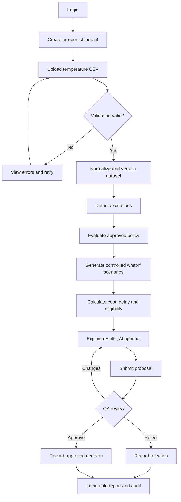
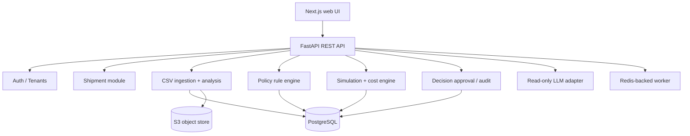

# Product Requirements Document (PRD)
## Cold Chain Decision Intelligence Platform
### MVP v1.0 — AI-Powered Transport Simulation

| Field | Value |
|---|---|
| Version | 1.0.0 |
| Status | Draft for Technical Review |
| Owner | Project Manager / Product Owner |
| Product | Multi-tenant B2B Web Application |
| Phase | Minimum Viable Product (MVP) |
| UI Language | English, Thai localization-ready |
| Updated | 2026-11-11 |

> **Core principle:** Every operational recommendation must be traceable, explainable, and constrained by validated quality and safety rules. Temperature logs alone cannot certify food safety. The MVP does not automatically release goods or issue vehicle commands.

---

# 1. Product Overview

## 1.1 Problem
Cold-chain shipments can experience abnormal temperatures. Logistics managers and quality-assurance (QA) officers must reconcile logger histories, shipment metadata, product-specific policies, recipient requirements and operational costs before choosing whether to hold, inspect, continue, reroute or reject a shipment. These inputs may be scattered across CSV/Excel files, PDFs and internal systems, causing delayed, inconsistent and poorly auditable decisions.

## 1.2 Solution
A web application that:
1. Imports shipment information and temperature histories.
2. Validates, normalizes and analyzes time-series data.
3. Detects and classifies temperature excursions.
4. Evaluates versioned product/quality policies using a deterministic rule engine.
5. Generates controlled what-if operational scenarios and compares costs, delays and eligibility.
6. Uses an LLM only to summarize and explain verified system outputs.
7. Supports human QA review, immutable decision snapshots and reports.

## 1.3 Objectives
| ID | Objective |
|---|---|
| OBJ-01 | Correct CSV-based temperature ingestion |
| OBJ-02 | Traceable excursion detection |
| OBJ-03 | Configurable, approved, versioned quality policies |
| OBJ-04 | Deterministic scenario eligibility enforcement |
| OBJ-05 | What-if cost/delay comparison |
| OBJ-06 | Grounded AI explanations with disclosed uncertainty |
| OBJ-07 | QA review and explicit approval workflow |
| OBJ-08 | Reproducible audit history and report export |
| OBJ-09 | Strict multi-tenant isolation |

## 1.4 Technical success criteria
- At least 95% excursion-detection recall on a pre-defined synthetic/reference test set; never replace edge-case tests with aggregate recall.
- **Zero** test cases where a HARD_BLOCK scenario is shown as executable/eligible.
- Cost engine matches an independently authored calculation oracle for all critical cases.
- End-to-end import → analysis → simulation → QA decision → report works.
- Dataset, policy, parameters and engine version are preserved per run.
- Cross-tenant authorization tests all pass.
- Core analysis works if the LLM is unavailable.

These are proposed *testing targets*, not achieved results or compliance certifications.

# 2. Scope and boundaries

## 2.1 In scope
- Email authentication, organization workspace and role-based access control (RBAC).
- Shipment creation, metadata, filtering and lifecycle.
- CSV upload, schema mapping, validation, normalization, dataset versioning and charting.
- Temperature excursion detection and data-gap handling.
- One reference product (initially **fresh strawberries**) with approved product-specific policy; extensible schema for others.
- Product profiles, policy drafting, approval, rule evaluation and policy history.
- Scenario templates: conditional delivery continuation, controlled hold/inspection, conditional reroute, quarantine/reject/disposal per policy.
- Deterministic incremental-cost engine, delay estimates, eligibility states and what-if recalculation.
- Grounded AI explanation as non-authoritative, optional enhancement.
- Decision proposal, QA approval/rejection/changes requested and auditable reports.
- Dashboard, list/detail screens, error/loading/empty states.

## 2.2 Out of scope
- Real-time IoT/device integration, live GPS or traffic, route optimization, automatic dispatch.
- ERP/TMS integrations, native mobile app and predictive biological shelf-life certification.
- Multi-product ML quality predictors, computer vision, autonomous AI agent.
- Automatic product release; overriding statutory/mandatory safety constraints.
- Customer billing and commercial business-planning features.

## 2.3 Safety and domain assumptions
All numeric food-quality thresholds must be provided or explicitly approved by a qualified domain expert/QA lead. Sample numbers in demos are illustrative **only**. Product quality acceptance and microbiological safety are separate claims. Unknown data, unapproved policy or ambiguous sensor interpretation must fail closed into **INSUFFICIENT_DATA** or **REVIEW_REQUIRED**, never auto-approve.

# 3. Users, roles and permissions

## 3.1 Personas
**Logistics Manager:** uploads shipment logs, reviews excursion details, explores what-if scenarios and proposes actions.

**QA Officer:** controls approved rules, reviews evidence, validates dispositions and records quality approvals/rejections.

**Organization Administrator:** manages users, roles and organization settings; not automatically a QA approver.

## 3.2 Permission matrix
| Capability | Admin | Logistics | QA |
|---|:---:|:---:|:---:|
| View shipments | ✓ | ✓ | ✓ |
| Create/edit open shipments | ✓ | ✓ | — |
| Upload temperature files | ✓ | ✓ | ✓ |
| Run simulations | ✓ | ✓ | ✓ |
| Edit draft policies | ✓ | — | ✓ |
| Approve policy versions | — | — | ✓ |
| Submit decision proposals | ✓ | ✓ | ✓ |
| Quality approval | — | — | ✓ |
| Manage members | ✓ | — | — |
| View audit logs | ✓ | — | ✓ |

One user may have multiple roles, but each approval must record the acting role. If separation of duties is enabled, proposer and approver must be different users. Backend authorization is mandatory on every resource.

# 4. User journeys and state machines

## 4.1 Main journey


## 4.2 Shipment status
`DRAFT → READY → IN_TRANSIT → ARRIVED → CLOSED`; `CANCELLED` where permissible. Shipment operational status and quality-disposition status must be separate. CLOSED records cannot be edited in place; subsequent correction creates revision/audit evidence.

## 4.3 Decision status
`DRAFT → PENDING_QA → APPROVED | REJECTED | CHANGES_REQUESTED`; updated proposals supersede earlier revisions (`SUPERSEDED`). QA approval must never silently override a HARD_BLOCK.

# 5. Functional requirements

Priority: **P0** release-critical; **P1** desired MVP enhancement.

## 5.1 Authentication and tenants
- **FR-A01 [P0]** Email login/logout, password reset, session expiry, secure password hashing or OIDC provider.
- **FR-A02 [P0]** Organization membership and access checks; server-side org scoping for reads, writes, exports and background jobs.
- **FR-A03 [P0]** Explicit authorization for policy approval and decision approval.
- **AC:** Unauthorized requests return 401/403; access to another org's IDs returns no contents; expired sessions cannot fetch protected data.

## 5.2 Shipment management
- **FR-B01 [P0]** Create shipment. Required: reference, product profile, origin, destination, departure and ETA. Optional: carrier, vehicle, lot, quantity/unit, declared value/currency, receiver and notes.
- **FR-B02 [P0]** Manage lifecycle and immutable revisions for closed shipment.
- **FR-B03 [P1]** Paginated list, reference search, filters by date/status/product and last-updated sort.
- **AC:** Reference uniqueness per organization; timezone-aware transport dates; ownership checks enforced.

## 5.3 CSV ingestion
- **FR-C01 [P0]** CSV requires timestamp and temperature; optional sensor ID, unit, humidity, location and quality flags. Default limit 10 MB and 100,000 records, configurable.
- **FR-C02 [P1]** User-visible mapping of timestamp/temp aliases; mapping must be confirmed when ambiguous.
- **FR-C03 [P0]** Validate types/units/duplicates/sorting/sensor consistency; normalize temperature to Celsius and times to UTC. Retain original timestamps/timezone and source file.
- **FR-C04 [P0]** Version each dataset and record checksum/source provenance; imported data never silently mutates a prior analysis.
- **AC:** Naive timestamps require user-supplied timezone; missing columns or malformed values yield actionable row-level error report; unit conversion is deterministic; duplicate policy documented.

Example:
```csv
timestamp,temperature,sensor_id
2026-11-11T09:00:00+07:00,4.2,SENSOR001
2026-11-11T09:05:00+07:00,4.5,SENSOR001
2026-11-11T09:10:00+07:00,5.1,SENSOR001
```

## 5.4 Temperature analysis
- **FR-D01 [P0]** Interactive temperature timeline showing thresholds, excursions, sensor ID and data gaps.
- **FR-D02 [P0]** Excursion engine outputs start/end, duration, min/max, peak deviation, event count and cumulative out-of-band duration.
- **FR-D03 [P0]** Time-weighted computation for irregular sampling; proposed rule: zero-order-hold between adjacent records only where gap ≤ configured maximum. Longer gaps are UNKNOWN, **not normal**. Last sample does not imply an unbounded interval.
- **FR-D04 [P0]** Classification `NORMAL`, `WARNING`, `CRITICAL`, `INDETERMINATE` according to versioned policy; classification is *not* product-release certification.
- **AC:** Multiple excursions, out-of-order records, sensor duplicates, start/end boundaries and gaps have deterministic reference fixtures. Charts must label missing intervals, not interpolate into safety evidence.

## 5.5 Product and policy engine
- **FR-E01 [P0]** Product profile: ID, organization, name, category, packaging, applicable policy, notes and active status.
- **FR-E02 [P0]** Policy: ID/version/product, effective period, temperature limits, continuous/cumulative duration limits, missing-data rules, QA actions, operational constraints, reference documents, approval metadata.
- **FR-E03 [P0]** Pure deterministic policy evaluator produces rule ID, input facts, result, violated constraints, required actions and unresolved information.
- **FR-E04 [P0]** Three rule effects: `HARD_BLOCK`, `REVIEW_REQUIRED`, `ADVISORY`. Hard blocks are non-tradeable against costs. Unknown/invalid policy disallows operational auto-clearance.
- **FR-E05 [P0]** Policy workflow `DRAFT → PENDING_REVIEW → APPROVED → RETIRED`; only approved applicable versions are used for operational evaluation. Each simulation pins policy version.
- **AC:** Same input plus same policy/engine version yields same output; an LLM cannot mutate policy; retired versions remain queryable for historical records.

## 5.6 Scenario and cost simulation
- **FR-F01 [P0]** Template-based scenarios: `CONTINUE_DELIVERY`, `HOLD_INSPECTION`, `CONDITIONAL_REROUTE`, `QUARANTINE_REJECT_DISPOSE`. These are candidates, **not** permission to act.
- **FR-F02 [P0]** Editable assumptions: additional transport, inspection, storage, handling, disposal, time delay, potential cargo loss, receiver acceptance, recovery value (where appropriate), source/uncertainty.
- **FR-F03 [P0]** Costs use decimal currency arithmetic:

  `DirectIncrementalCost = Transport + Inspection + Storage + Handling + Disposal + Other`

  Optional *only if defensible probabilities exist*:

  `ExpectedIncrementalCost = DirectIncrementalCost + Σ(P(event_i) × Loss_i) − ExpectedRecoveryValue`

  Display observed, user-estimated and modeled components separately; do not invent probabilities.
- **FR-F04 [P0]** Scenario states: `ELIGIBLE`, `REVIEW_REQUIRED`, `BLOCKED`, `INSUFFICIENT_DATA`. Only eligible alternatives can be ranked as operationally executable; QA-gated ones remain conditional. If all alternatives are blocked/unknown, show hold/escalation.
- **FR-F05 [P1]** Rank eligible scenarios using transparent normalized cost/delay weights. Never optimize safety constraints as if they were tradeable metrics; unknown risk must remain visible.
- **FR-F06 [P0]** Recalculate on changed assumptions; create a new run/revision rather than mutating a submitted result.
- **AC:** Input assumptions and derived outputs are visible; no division-by-zero ranking on equal values; numeric tests include currencies, zero amounts, negative/invalid parameters, rounding and extreme cargo values.

## 5.7 AI explanation
- **FR-G01 [P1]** Summarize excursions using structured deterministic results.
- **FR-G02 [P1]** Explain tradeoffs, blocking rules, unknowns and needed QA actions.
- **FR-G03 [P0 when AI enabled]** Validate generated JSON against schema: `summary`, `key_findings`, `scenario_explanations`, `uncertainties`, `required_reviews`, `source_references`.
- **FR-G04 [P0]** AI is read-only toward policy/eligibility/approvals; may not invent measurements, costs, probabilities or safety claims. Validate citations against actual rule/dataset references. Prompt-injection test all imported text. Fail gracefully if provider is down.
- **AC:** LLM-disabled system completes all mandatory deterministic functions; AI explanation never changes scenario state; ungrounded output is rejected or replaced with template explanation.

## 5.8 Decision and QA approval
- **FR-H01 [P0]** Submit a proposed scenario with justification, proposer, timestamp and pinned simulation run.
- **FR-H02 [P0]** Support decision workflow statuses and permitted transitions.
- **FR-H03 [P0]** QA views full evidence; can approve, reject or request changes with notes; ensure permission/separation of duties.
- **FR-H04 [P0]** Persist immutable decision snapshot: source dataset hash/version, policy version, engine version, scenario parameters, results, AI explanation/model version (if used), proposer and reviewer.
- **AC:** A blocked action cannot be approved through normal flow; stale proposal/revision cannot accidentally be approved; concurrent approvals are transaction-safe.

## 5.9 Dashboard and reports
- **FR-I01 [P1]** Overview metrics for shipments, excursions, pending QA reviews and recent decisions.
- **FR-I02 [P0]** Shipment analysis combines timeline, policy, anomalies, scenarios and decisions.
- **FR-I03 [P1]** PDF decision report with shipment, temperature summary, evidence, rule outcomes, assumptions, scenarios, reviewer and pinned versions.
- **AC:** Report data matches immutable decision snapshot; exported document access is tenant scoped.

# 6. UX/UI specification

## 6.1 Information architecture
```text
Dashboard
Shipments
  Shipment list / Create / Detail
    Overview / Temperature analysis / Quality evaluation
    Simulations / Decision history
Simulations
  Workspace / Compare scenarios
Quality management
  Products / Policies / Versions
Decisions
  Pending reviews / Decision detail / History
Reports
Settings
  Organization / Members / Audit
```

## 6.2 Required screens
| Screen | Priority |
|---|---|
| Login, shipment list/create/detail | P0 |
| CSV upload/schema mapping/validation | P0 |
| Temperature chart and excursion detail | P0 |
| Product profile and policy editor | P0 |
| Simulation workspace and comparison | P0 |
| Decision review/history | P0 |
| Dashboard and report preview | P1 |
| Organization settings | P1 |

## 6.3 Simulation workspace
1. Shipment header and data freshness/version badge.
2. Timeline with excursions and UNKNOWN intervals.
3. Policy status and citations to rule IDs.
4. Side-by-side scenario cards: eligibility, cost, delay, assumption source and QA dependency.
5. Editable what-if parameters + recalculation control.
6. Grounded explanatory panel with explicit limitations.
7. Save proposal / submit to QA; blocked action has no executable CTA.

All async screens must have loading, empty, error, permission-denied and retry states. Never convey risk with color alone; pair color with text/icon.

# 7. Suggested architecture

## 7.1 Modular monolith
Use a modular-monolith backend to simplify cross-module data consistency, testing and deployment; split into services only when justified by scale or team boundaries.



## 7.2 Proposed stack
| Layer | Suggested option |
|---|---|
| Frontend | Next.js, TypeScript, Tailwind, shadcn/ui |
| Charts | Apache ECharts |
| Backend | Python, FastAPI, Pydantic |
| Database | PostgreSQL, SQLAlchemy, Alembic |
| Object files | S3-compatible storage |
| Background jobs | Redis + RQ or Celery |
| LLM | Provider-agnostic structured-output adapter |
| Authentication | Secure session or managed OIDC provider |
| Testing | pytest, Vitest, Playwright |
| Deployment | Docker / Docker Compose for MVP |
| Monitoring | Structured logs, metrics, error tracking |

Technology choices are proposed and should be finalized in an Architecture Decision Record (ADR).

## 7.3 Backend module boundaries
```text
backend/app/
  api/ core/ auth/ organizations/ shipments/
  products/ policies/ temperature/ excursions/
  simulations/ ai/ decisions/ reports/ audit/
  workers/ db/ schemas/
```

Rules and calculations must be independently testable pure functions/services. Endpoint handlers should orchestrate rather than contain business calculations.

# 8. Logical data model

All tenant-owned entities have `organization_id` and indexed tenant-scoped foreign keys.

| Entity | Key fields |
|---|---|
| Organization | id, name, status, created_at |
| User | id, email, identity credentials/provider, status |
| OrganizationMembership | organization_id, user_id, roles, status |
| Product | id, organization_id, name, category, packaging, active |
| QualityPolicy | id, organization_id, product_id, version, status, rules_json, reference, effective_at, approver |
| Shipment | id, organization_id, reference, product_id, origin, destination, departure, ETA, status, cargo_value, currency |
| TemperatureDataset | id, organization_id, shipment_id, version, file_path, SHA256, uploader, row_count, timezone, validation_status |
| TemperatureReading | id, organization_id, dataset_id, sensor_id, timestamp_utc, temperature_c, quality_flag |
| ExcursionEvent | id, organization_id, dataset_id, policy_version_id, interval, min/max, duration, classification, rule_id |
| SimulationRun | id, organization_id, shipment_id, dataset_version_id, policy_version_id, params_json, engine_version, status, creator |
| SimulationScenario | id, organization_id, run_id, type, params, eligibility, cost, delay, evaluation_json |
| Decision | id, organization_id, run_id, selected_scenario, status, proposer, reviewer, review notes, snapshot_json |
| AuditLog | id, organization_id, actor, action, entity, before/after hashes or snapshots, timestamp |

Use UUID keys, UTC timestamps, `NUMERIC`/Decimal for money and explicit temperature precision; preserve immutable raw files and pinned references. Explicit database constraints and access policies should prevent cross-tenant joins. Define retention/deletion controls before production onboarding.

# 9. Draft REST API contract

Base prefix `/api/v1` with authenticated JSON, OpenAPI docs, standardized validation errors, pagination, correlation IDs and idempotency where needed.

| Domain | Endpoints |
|---|---|
| Auth | `POST /auth/login`, `POST /auth/logout`, `GET /auth/me` |
| Organization | `GET /organizations/current`, `GET /organizations/current/members`, `POST /organizations/current/members` |
| Shipments | `GET /shipments`, `POST /shipments`, `GET /shipments/{id}`, `PATCH /shipments/{id}` |
| Datasets | `POST /shipments/{id}/temperature-datasets`, `GET /shipments/{id}/temperature-datasets`, `GET /temperature-datasets/{id}/readings`, `GET /temperature-datasets/{id}/validation` |
| Analysis | `POST /shipments/{id}/analyses`, `GET /analyses/{id}`, `GET /analyses/{id}/excursions` |
| Products/policies | `GET /products`, `POST /products`, `GET /quality-policies`, `POST /quality-policies`, `GET /quality-policies/{id}`, `POST /quality-policies/{id}/submit-review`, `POST /quality-policies/{id}/approve` |
| Simulations | `POST /shipments/{id}/simulations`, `GET /simulations/{id}`, `GET /simulations/{id}/scenarios`, `POST /simulations/{id}/recalculate` |
| Decisions | `POST /decisions`, `GET /decisions`, `GET /decisions/{id}`, `POST /decisions/{id}/submit`, `POST /decisions/{id}/approve`, `POST /decisions/{id}/reject`, `POST /decisions/{id}/request-changes` |
| Reports | `POST /decisions/{id}/reports`, `GET /reports/{id}` |
| Audit | `GET /audit-logs` |

Example simulation request:
```json
{
  "dataset_id": "<dataset-uuid>",
  "policy_id": "<approved-policy-version-uuid>",
  "scenario_types": ["CONTINUE_DELIVERY", "HOLD_INSPECTION", "CONDITIONAL_REROUTE"],
  "parameters": {
    "currency": "THB",
    "inspection_cost": "1500.00",
    "holding_cost": "2000.00",
    "reroute_cost": "5000.00"
  }
}
```
Sample costs are non-production illustrations.

Example response fragment:
```json
{
  "simulation_id": "<simulation-uuid>",
  "status": "COMPLETED",
  "policy_version": "1.0",
  "scenarios": [{
    "type": "HOLD_INSPECTION",
    "eligibility": "REVIEW_REQUIRED",
    "incremental_cost": "3500.00",
    "currency": "THB",
    "additional_delay_minutes": 360,
    "requires_qa_approval": true,
    "violated_rules": [],
    "explanation": "Quality inspection required."
  }]
}
```

# 10. Non-functional requirements

| ID | Requirement | Initial target |
|---|---|---|
| NFR-01 | Typical API response (non-background) | p95 < 500 ms |
| NFR-02 | Import/validate 100k records | < 30 s on documented benchmark environment |
| NFR-03 | Analyze 100k records | < 10 s on same environment |
| NFR-04 | Deterministic simulation | < 3 s, excluding AI |
| NFR-05 | Dashboard load | p95 < 3 s in benchmark environment |

All performance metrics require a documented reference machine, concurrency and dataset. Set reliability rules for retries, idempotency, safe job failure and backup recovery. Security baseline: TLS, password/OIDC security, RBAC, server-side tenant isolation, upload scanning/limits, request validation, rate limiting, secret management, dependency scanning, prompt-injection controls and limited external AI data sharing. Audit and log all approvals without logging unnecessary sensitive data. AI provider outages must not impair deterministic workflows.

# 11. Test and QA strategy

## 11.1 Layers
- **Unit:** units/timezones, interval math, gap handling, rule effects, decimal costs, eligibility, ranking, state transitions.
- **Integration:** upload→analysis, policy→simulation, simulation→decision, report snapshots, transaction integrity, permissions.
- **E2E:** create shipment→upload→inspect excursion→simulate→submit→QA review→export.
- **AI:** schema adherence, hallucination/citation checking, prompt-injection attempts, unknown-data disclosure and outage fallback.
- **Security:** cross-org IDOR/tenant tests, improper approval, malicious CSV, object-storage URLs and audit tampering.

## 11.2 Critical cases
| ID | Case | Expected result |
|---|---|---|
| TC-001 | Valid CSV | Imported, versioned |
| TC-002 | Missing timestamp | Row/column error |
| TC-003 | Duplicate timestamps | Deterministic documented handling |
| TC-004 | Out-of-order rows | Sorted normalized data |
| TC-005 | Oversized sampling gap | UNKNOWN interval, not clearance |
| TC-006 | No excursion | NORMAL only when policy/data sufficient |
| TC-007 | Above upper threshold | Excursion detected |
| TC-008 | Several excursions | Accurate event count and cumulative duration |
| TC-009 | HARD_BLOCK | Scenario marked BLOCKED |
| TC-010 | Missing approved policy | Operational approval unavailable |
| TC-011 | Cost change | Correct new run and recomputation |
| TC-012 | Blocked decision submission | Rejected server-side |
| TC-013 | Non-QA approval attempt | 403 |
| TC-014 | Cross-tenant ID access | Denied |
| TC-015 | LLM timeout | Deterministic result still available |
| TC-016 | Policy version changes | Old run unchanged |
| TC-017 | Dataset re-upload | New version; old run preserved |
| TC-018 | Concurrent QA actions | Only valid atomic transition |
| TC-019 | Export report | Exact snapshot match |
| TC-020 | Injection in CSV metadata | No policy/action/privilege alteration |

## 11.3 Release exit criteria
- All P0 items implemented and reviewed.
- All critical tests pass; no open unacceptable critical/high vulnerabilities.
- Reference policy approved by a qualified QA/domain reviewer.
- Every decision is reproducible by source hashes, versions and parameters.
- LLM-free core passes end-to-end test.
- Deployment, backup/restore and rollback procedures documented.

# 12. Delivery plan

Assumption: 2–3 engineers with full-stack/backend skills plus access to domain QA. Proposed sprints of 1–2 weeks; dates and estimates must be refined after technical spikes.

| Sprint | Deliverable |
|---|---|
| 0 | Architecture decisions, schema, reference QA policy, annotated fixtures and UX wireframes |
| 1 | Authentication, tenants, roles, shipment CRUD |
| 2 | CSV ingestion, validation, normalization, timeline |
| 3 | Excursion engine, products, policy workflow |
| 4 | Scenario engine, eligibility, costs and what-if comparison |
| 5 | AI explanations, decisions, QA approval and audit |
| 6 | Reports, E2E, performance/security hardening, staging/deployment |

**Workstreams:** Platform Foundation; Temperature Intelligence; Policy/Decision Intelligence; AI and Approval; Frontend UX; Quality Assurance.

**Milestone gates:**
- M1: Multi-tenant shipments usable.
- M2: Reference temperature fixture analyzed correctly.
- M3: Scenario outputs deterministic and hard constraints enforced.
- M4: End-to-end human QA workflow and immutable evidence.
- M5: Release candidate passes defined tests/security review.

# 13. Definition of Done

A feature is done when implementation matches its acceptance criteria, code review passes, relevant unit/integration tests pass, auth/tenant boundaries are verified, UI has all appropriate states, API/DB migrations/docs are updated, audit events exist where required, and no open critical defect is associated with it. Rule and simulation changes additionally require a golden test fixture with expected outputs.

# 14. Risks and mitigations

| Risk | Severity | Mitigation |
|---|---|---|
| Invalid product/QA rules | Critical | Qualified QA approval, evidence, versioning |
| Wrong duration interpretation | High | Explicit interval assumptions and edge-case fixtures |
| AI fabricated conclusions | High | Structured output and verified deterministic source |
| Missing logger data | High | Unknown-state policy and escalation |
| Cost arithmetic errors | Medium | Decimal and reference oracle tests |
| Cross-tenant leakage | Critical | Defense-in-depth scoping and security tests |
| Historical decision mutation | High | Immutable pinned snapshots |
| Slow imports/simulations | Medium | Async workers and benchmarking |
| External LLM outage | Medium | Template explanations and graceful fallback |
| Too much customer-specific logic | Medium | Configuration-driven policy templates |

# 15. Dependencies and open decisions

## 15.1 Dependencies
- Legitimately sourced reference temperature datasets and metadata.
- Approved strawberry quality/receiver policy with domain expert evidence.
- Documented operational scenarios and actual/assumed cost parameters.
- Staging database, object storage and worker infrastructure.
- QA stakeholder for rule review and scenario acceptance.

## 15.2 Architecture decisions for Sprint 0
| ID | Decision | Proposed starting point |
|---|---|---|
| TD-01 | Frontend | Next.js |
| TD-02 | Backend | FastAPI |
| TD-03 | Database | PostgreSQL |
| TD-04 | Authentication | Managed OIDC / secure sessions |
| TD-05 | Object storage | S3 compatible |
| TD-06 | LLM | Provider agnostic |
| TD-07 | Async queue | Redis + worker |
| TD-08 | Deployment | Docker Compose for MVP |
| TD-09 | Product scope | One reference product |
| TD-10 | Canonical temperature | Celsius |
| TD-11 | Canonical timezone | UTC |
| TD-12 | Base currency | THB, currency-aware schema |
| TD-13 | Safety | Deterministic QA-approved rules |
| TD-14 | Action authorization | Human in the loop |
| TD-15 | Retention | Configurable, decided before real onboarding |

# 16. Release checklist

### Product and QA
- [ ] Complete the principal journey end to end.
- [ ] Implement all P0 requirements.
- [ ] Validate reference QA policy and test fixtures.
- [ ] Verify all mandatory approval transitions.
- [ ] Verify reports against immutable snapshots.

### Engineering
- [ ] CI and automated test suites green.
- [ ] Database migrations and rollback tested.
- [ ] APIs documented with OpenAPI.
- [ ] Authentication/authorization and tenant tests passed.
- [ ] CSV upload and prompt-injection security tested.
- [ ] Performance and failure/retry benchmarks recorded.
- [ ] Staging/production config, monitoring, backup and runbooks ready.

# 17. Final MVP acceptance statement

An authorized user can create a shipment, import a temperature history, inspect the validated timeline and excursions, apply a pinned approved policy, compare eligible and conditional what-if actions, understand assumptions and rule-backed explanations, propose an action, obtain explicit QA review, and export a reproducible audit report. Unknown evidence must remain unknown; blocked safety actions must not be operationally executable; and none of these capabilities may depend on an LLM granting approval.

**Document status:** Ready for technical review, not yet a locked engineering specification. Finalize verified domain rules, reference fixtures and core ADRs before implementing the safety-sensitive rule engine.
