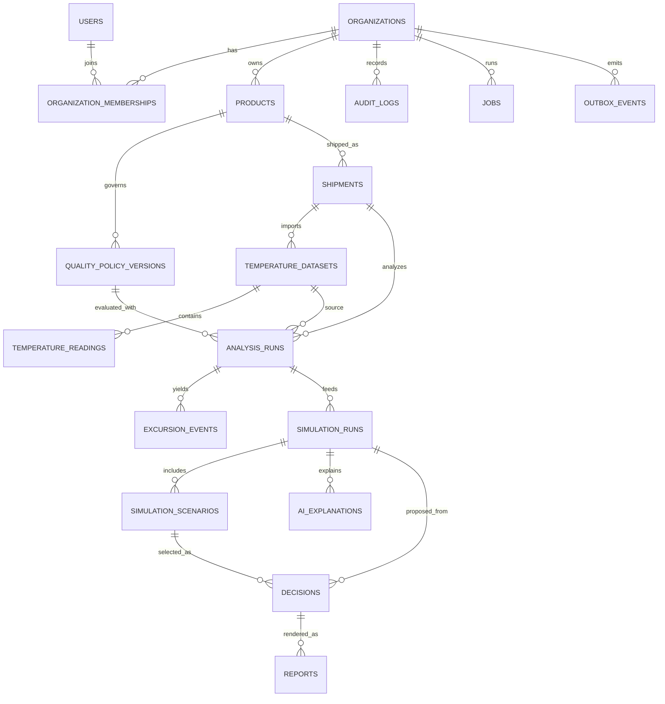

# DATABASE.md — Physical Data Model & Persistence Contract

**Product:** Cold Chain Decision Intelligence Platform / Transport Simulation  
**Target:** MVP v1.0 · **Version:** 1.0.1 · **Status:** Proposed for Sprint-0 review
**Date:** 2026-11-11 · **DBMS:** PostgreSQL 16+ · **ORM:** SQLAlchemy 2 · **Migration:** Alembic  
**References:** `Cold_Chain_Decision_Intelligence_PRD_MVP_v1.0.md`, `ARCHITECTUR.md`, `API.md`, `AGENT.md`, `claude.md`

> Implementation contract, not a claim that schema or product-specific quality rules are approved. `ARCHITECTUR.md` owns architectural invariants, `API.md` owns external field names and endpoint behavior. Any contract change requires corresponding documentation, migration, and tests. Example values are synthetic and **never approved safety limits**.

## S0–S6 physical implementation notes

Pre-merge review correction (ADR 0004): `analysis_runs.result.coverage_window` pins the window used by engine 1.1.0 and its input hash. No historical result is rewritten. Decision writers serialize on the organization transaction lock before row locks and enforce one current PENDING_QA/APPROVED decision per shipment through the simulation relationship; this invariant is enforced by the API, not a database partial index. Correction submission atomically supersedes the predecessor without changing its snapshot. Tenant membership activation only resolves pre-provisioned PENDING rows within the administrator's own tenant.

The detailed proposal below is retained for review. The executable schema is `services/api/app/models.py` with Alembic revisions `0001`–`0006`; these notes resolve physical differences from the illustrative DDL:

- IDs are canonical UUID strings stored as VARCHAR(36), including tenant composite foreign keys (ADR 0002). JSON documents use PostgreSQL JSONB; money uses NUMERIC and API decimal strings.
- Identity uses `users.identity_subject`, `sessions`, `organization_memberships` and normalized `membership_roles`. OIDC identity provisioning is separate from membership assignment.
- `temperature_readings` is typed and indexed by tenant/dataset/sensor/time. Raw object keys, hash, mapping, timezone and version remain on `temperature_datasets`; errors are capped samples inside its validation JSON.
- Excursions, unknown intervals and rule results are frozen JSON on `analysis_runs`; there is no separate mutable excursion table. Source-chain triggers verify shipment/dataset/product/policy associations.
- Scenarios are typed `simulation_scenarios` rows plus immutable result JSON. `decisions.snapshot` pins provenance and deterministic results at submission. `reports.frozen_payload` additionally freezes review metadata at report request.
- `jobs` and `outbox_events` commit alongside queued resources. Completed artifacts, reference documents, approved policies, decision snapshots and audit events are protected by triggers. Inserts into completed datasets/scenarios are also rejected.
- Forced RLS scopes domain tables via transaction-local `cc.organization_id`. Identity and membership lookup uses explicit server authorization before setting that context. Production credentials must be non-owner and NOBYPASSRLS; CI proves the non-owner read boundary.
- Keyset lists default to immutable creation time. Raw readings use timestamp/ID. Updated-time sorting is explicitly unsupported in this candidate; see ADR 0003.

The PostgreSQL test suite exercises actual migrations, concurrent review/reference/version allocation, immutable evidence and non-bypass RLS. CI restore verifies decision snapshot hashes plus database-to-object references in a new database and bucket. Environment/retention and qualified QA sign-off remain human gates.

## 1. Design invariants

1. **Tenant boundary:** every tenant-owned entity has `organization_id UUID NOT NULL`; tenant derived from authenticated membership (`X-Organization-Id` is a selector, not authority). Composite foreign keys must prevent cross-tenant parent references. Return 404 for out-of-tenant resources.
2. **Immutable evidence:** raw uploaded files, completed datasets, approved/retired policy bodies, completed analysis/simulation results, submitted decision snapshots, and generated report artifacts are immutable. Changes create new versions/runs, not in-place rewrites.
3. **Deterministic decisions:** pin `dataset_id`, `policy_version_id`, engine/template versions, input digest and calculations. LLM outputs are separate commentary; never write them into eligibility, policy or cost truth fields.
4. **Fail closed:** unknown gaps, missing approved policy, invalid data, or insufficient evidence cannot be treated as product release eligibility. Holding/escalation actions may remain viable where approved policy permits.
5. **Transactions and concurrency:** optimistic `revision`/ETag for mutable operational records and row locks for terminal QA transitions. Domain changes and outbox record creation share one transaction.
6. **Privacy and recoverability:** tenant-scoped access, encrypted storage and transport, point-in-time backup strategy, documented retention/deletion policy, no secrets or complete raw files in logs.

## 2. Conventions and naming

| Concern | Rule |
|---|---|
| PK | `id UUID PRIMARY KEY`, generated in application or `gen_random_uuid()` |
| Tenant FK | `organization_id UUID NOT NULL REFERENCES organizations(id)` |
| Cross-tenant FK | Parent has `UNIQUE (organization_id,id)` and child references `(organization_id,parent_id)` |
| UTC times | `TIMESTAMPTZ`; all API response timestamps RFC3339 UTC |
| Money | `NUMERIC(18,2)` nonnegative when cost; ISO 4217 `CHAR(3)`; never `FLOAT` |
| Temperature | `NUMERIC(8,3)` in Celsius; raw representation retained via original file |
| Durations | `INTEGER` seconds or minutes; nonnegative CHECK |
| Revision | `revision INTEGER NOT NULL DEFAULT 1 CHECK (revision > 0)` where concurrent mutation is possible |
| JSONB | Versioned schemas only; not a substitute for tenant FK or important relational constraints |
| Hashes | lowercase SHA-256 hex `CHAR(64)`; hash canonical serialized payload where deterministic replay is needed |
| IDs in REST | UUID v4; internal events may use UUIDv7/UUIDv4 consistently if agreed in ADR |
| Delete | RESTRICT evidence deletes; tenant offboarding via documented retention workflow, no blanket cascading deletes |
| Enum | Prefer `TEXT + CHECK` or lookup tables, not PostgreSQL ENUM for frequently evolving states |

**Constraint naming:** `pk_<table>`, `fk_<table>_<parent>`, `uq_<table>_<columns>`, `ck_<table>_<rule>`, `ix_<table>_<columns>`.

**Critical PostgreSQL caveat:** PostgreSQL `UNIQUE` treats NULL values as distinct (unless `NULLS NOT DISTINCT` is used). Use non-null columns or partial unique indexes for deduplication invariants.

## 3. Relational model (logical ERD)



## 4. Table-by-table schema

All tenant tables below have `organization_id`, `created_at` (where applicable), plus `UNIQUE (organization_id,id)` for composite FK targets; list these implicitly where omitted. All FK relations to tenant tables are **composite tenant-safe foreign keys**, not ID-only.

### 4.1 Identity and tenant

**`organizations`**
- `id UUID PK`, `name TEXT NOT NULL`, `status TEXT NOT NULL DEFAULT 'ACTIVE' CHECK IN ('ACTIVE','SUSPENDED','CLOSED')`, `require_separation_of_duties BOOLEAN NOT NULL DEFAULT TRUE`, `created_at TIMESTAMPTZ NOT NULL DEFAULT now()`, `updated_at TIMESTAMPTZ NOT NULL DEFAULT now()`.
- Organization creation via trusted admin/bootstrap path, **not** unchecked public endpoint.

**`users`** (global identity)
- `id UUID PK`, `identity_subject TEXT NOT NULL UNIQUE` (OIDC `issuer|sub` canonical binding; do not use email as identity), `email CITEXT`, `name TEXT`, `status TEXT NOT NULL DEFAULT 'ACTIVE'`, `created_at TIMESTAMPTZ`, `updated_at TIMESTAMPTZ`.
- Unique OIDC subject; **email need not be unique** across providers; use `citext` only after migration enables extension.

**`organization_memberships`**
- `id UUID PK`, `organization_id UUID`, `user_id UUID REFERENCES users(id)`, `roles TEXT[] NOT NULL`, `status TEXT NOT NULL CHECK IN ('INVITED','ACTIVE','DISABLED')`, `created_at`, `updated_at`.
- `UNIQUE (organization_id,user_id)`; CHECK roles nonempty, each role in `ADMIN`, `LOGISTICS`, `QA` (validated via trigger or normalized member-role table; app validation alone is insufficient for DB-enforced role vocabulary).
- Role checks also performed in application service; admin does not imply QA.

### 4.2 Products, policies and referenced evidence

**`products`**
- `id`, `organization_id`, `name TEXT NOT NULL`, `category TEXT NOT NULL`, `packaging_type TEXT`, `active BOOLEAN NOT NULL DEFAULT TRUE`, `created_at`, `updated_at`, `revision`.
- `UNIQUE (organization_id,name)` if product catalog requires names to be unique; otherwise use tenant SKU field and unique SKU instead (Sprint-0 decision).

**`reference_documents`** (add to support referenced policy evidence)
- `id`, `organization_id`, `object_key TEXT NOT NULL`, `sha256 CHAR(64) NOT NULL`, `filename TEXT`, `content_type TEXT`, `uploaded_by UUID`, `created_at`; raw document storage private; immutable record.

**`quality_policy_versions`**
- `id`, `organization_id`, `product_id`, `policy_key TEXT NOT NULL`, `version INTEGER NOT NULL CHECK > 0`, `status TEXT NOT NULL CHECK IN ('DRAFT','PENDING_REVIEW','APPROVED','RETIRED')`, `rules_jsonb JSONB NOT NULL`, `rule_schema_version TEXT NOT NULL`, `reference_document_id UUID`, `effective_from TIMESTAMPTZ`, `effective_to TIMESTAMPTZ`, `approved_by UUID`, `approved_at TIMESTAMPTZ`, `content_sha256 CHAR(64)`, `revision INTEGER NOT NULL DEFAULT 1`, `created_at`, `updated_at`.
- Composite FKs to `products` and `reference_documents`; `UNIQUE (organization_id,policy_key,version)`; CHECK effective end later than start; approval metadata consistent with APPROVED/RETIRED state.
- *No automatic policy auto-approval.* QA permission and documented reference approval required.
- Once approved, never change `rules_jsonb`, rule schema, product link or approval signature. `RETIRED` is a lifecycle status change only.
- Product-specific numeric thresholds intentionally **not defined** in this document.

### 4.3 Shipments and datasets

**`shipments`**
- `id`, `organization_id`, `reference TEXT NOT NULL`, `product_id UUID NOT NULL`, `origin JSONB NOT NULL`, `destination JSONB NOT NULL`, `departure_at TIMESTAMPTZ`, `estimated_arrival_at TIMESTAMPTZ`, `carrier TEXT`, `vehicle_reference TEXT`, `batch_reference TEXT`, `quantity NUMERIC(18,3)`, `quantity_unit TEXT`, `cargo_value NUMERIC(18,2)`, `currency CHAR(3)`, `status TEXT NOT NULL CHECK IN ('DRAFT','READY','IN_TRANSIT','ARRIVED','CLOSED','CANCELLED')`, `revision`, `created_at`, `updated_at`.
- `UNIQUE (organization_id,reference)`; composite FK product; CHECK arrival > departure where both present; CHECK positive quantity if supplied.
- Shipment operational status **distinct** from QA decision disposition.

**`temperature_datasets`**
- `id`, `organization_id`, `shipment_id`, `version INTEGER NOT NULL`, `raw_object_key TEXT NOT NULL`, `sha256 CHAR(64) NOT NULL`, `original_filename TEXT`, `mapping_jsonb JSONB NOT NULL`, `source_timezone TEXT NOT NULL`, `status TEXT NOT NULL CHECK IN ('UPLOADED','VALIDATING','READY','INVALID','FAILED')`, `row_count INTEGER`, `validation_summary_jsonb JSONB`, `uploaded_by UUID`, `created_at`, `completed_at`.
- `UNIQUE (organization_id,shipment_id,version)`; new upload always creates new version; no overwrite of READY rows.
- Store the exact original file in private object storage with hash check, validated content type, malware/CSV-formula risk handling on exports; no unauthenticated object URLs.

**`temperature_readings`**
- `id`, `organization_id`, `dataset_id`, `sensor_id TEXT NOT NULL DEFAULT 'default'`, `timestamp_utc TIMESTAMPTZ NOT NULL`, `temperature_c NUMERIC(8,3) NOT NULL`, `quality_flag TEXT NOT NULL DEFAULT 'VALID'`, `source_row INTEGER NOT NULL CHECK > 0`, `created_at`.
- `UNIQUE (organization_id,dataset_id,source_row)`; `INDEX (organization_id,dataset_id,sensor_id,timestamp_utc)`; do **not** blindly `UNIQUE (dataset_id,sensor_id,timestamp_utc)` because duplicates/conflicts must first be recognized explicitly during validation.
- Only normalized valid rows are analyzable; invalid/conflicting readings are recorded in validation results, not quietly discarded or treated as safe intervals.

### 4.4 Analysis and simulations

**`analysis_runs`**
- `id`, `organization_id`, `shipment_id`, `dataset_id`, `policy_version_id`, `engine_version TEXT NOT NULL`, `status TEXT NOT NULL CHECK IN ('QUEUED','RUNNING','COMPLETED','FAILED')`, `summary_jsonb JSONB`, `input_sha256 CHAR(64)`, `job_id UUID`, `created_by UUID`, `created_at`, `completed_at`.
- Composite references to shipment/dataset/policy. Application + DB trigger or deferred constraint verifies dataset belongs to shipment and policy belongs to shipment's product. Never infer this from matching tenant alone.
- Completed summary immutable; if re-analysis required create new run.

**`excursion_events`**
- `id`, `organization_id`, `analysis_run_id`, `sensor_id TEXT`, `start_at TIMESTAMPTZ`, `end_at TIMESTAMPTZ`, `duration_seconds INTEGER`, `min_c NUMERIC(8,3)`, `max_c NUMERIC(8,3)`, `rule_id TEXT NOT NULL`, `classification TEXT CHECK IN ('NORMAL','WARNING','CRITICAL','INDETERMINATE')`, `created_at`.
- CHECK `end_at >= start_at`, duration nonnegative. Missing data segments are preserved in `analysis_runs.summary_jsonb` or, preferably, a separate `analysis_data_gaps` table if the UI needs row-level querying; **never create a pseudo-safe event for unknown intervals**.

**`simulation_runs`**
- `id`, `organization_id`, `shipment_id`, `analysis_run_id`, `dataset_id`, `policy_version_id`, `engine_version TEXT`, `template_version TEXT`, `status TEXT CHECK IN ('QUEUED','RUNNING','COMPLETED','FAILED')`, `assumptions_jsonb JSONB`, `input_sha256 CHAR(64)`, `created_by UUID`, `parent_run_id UUID`, `created_at`, `completed_at`.
- Cross-validate source chain. Recalculate creates child run with `parent_run_id` tenant FK, never mutates original.

**`simulation_scenarios`**
- `id`, `organization_id`, `simulation_run_id`, `type TEXT CHECK IN ('CONTINUE_DELIVERY','HOLD_INSPECTION','CONDITIONAL_REROUTE','REJECT_QUARANTINE_DISPOSE')`, `eligibility TEXT CHECK IN ('ELIGIBLE','REVIEW_REQUIRED','BLOCKED','INSUFFICIENT_DATA')`, `costs_jsonb JSONB NOT NULL`, `currency CHAR(3)`, `incremental_cost NUMERIC(18,2)`, `delay_minutes INTEGER`, `risk_classification TEXT`, `evaluation_jsonb JSONB NOT NULL`, `ranking_score NUMERIC(12,6)`, `created_at`.
- CHECK incremental cost/delay nonnegative if supplied. `ranking_score` nullable for blocked/unknown scenarios. Source of probabilities & uncertainties mandatory when present in JSON.
- Template `HOLD_INSPECTION` does not automatically imply eventual authorization to release.

**`ai_explanations`**
- `id`, `organization_id`, `simulation_run_id`, `model TEXT`, `prompt_version TEXT`, `schema_version TEXT`, `source_digest CHAR(64)`, `content_jsonb JSONB`, `status TEXT CHECK IN ('QUEUED','COMPLETED','FAILED','SKIPPED')`, `created_at`, `completed_at`.
- AI outputs never overwrite scenario calculations, safety flags or policy evaluations.

### 4.5 Decisions, reports, immutable evidence

**`decisions`**
- `id`, `organization_id`, `simulation_run_id`, `scenario_id`, `status TEXT CHECK IN ('DRAFT','PENDING_QA','CHANGES_REQUESTED','APPROVED','REJECTED','SUPERSEDED')`, `justification TEXT`, `snapshot_jsonb JSONB`, `snapshot_sha256 CHAR(64)`, `submitted_by UUID`, `submitted_at TIMESTAMPTZ`, `reviewed_by UUID`, `reviewed_at TIMESTAMPTZ`, `review_notes TEXT`, `revision INTEGER`, `supersedes_decision_id UUID`, `created_at`, `updated_at`.
- Verify chosen scenario belongs to same simulation via composite `(organization_id,simulation_run_id,scenario_id)` FK against unique index on scenarios `(organization_id,simulation_run_id,id)`.
- At submission: snapshot original dataset hash, policy hash/version, engine versions, parameters, scenario evaluation, actor, and AI explanation digest (if any); content hash from canonical JSON. Snapshot immutable after submission.
- QA transition: `SELECT ... FOR UPDATE`, require valid `If-Match` revision; role QA, policy evidence and separation of duties; no hard-block bypass; terminal decisions never return to draft.
- `CHANGES_REQUESTED` correction model for MVP: **create a new DRAFT decision with `supersedes_decision_id`**, keeping the original submitted snapshot untouched. Prior decision can be marked SUPERSEDED through a separately audited authorized transition. This resolves ambiguous inline-edit behavior.

**`reports`**
- `id`, `organization_id`, `decision_id`, `decision_snapshot_sha256 CHAR(64) NOT NULL`, `object_key TEXT`, `report_sha256 CHAR(64)`, `format TEXT NOT NULL DEFAULT 'PDF'`, `status TEXT CHECK IN ('QUEUED','RUNNING','COMPLETED','FAILED')`, `job_id UUID`, `created_at`, `completed_at`.
- Report generated from decision snapshot only; signed/private download authorization checked each time.

**`audit_logs`**
- `id`, `organization_id`, `actor_id UUID`, `acting_role TEXT`, `action TEXT NOT NULL`, `entity_type TEXT NOT NULL`, `entity_id UUID`, `before_digest CHAR(64)`, `after_digest CHAR(64)`, `metadata_jsonb JSONB`, `request_id TEXT`, `created_at`.
- Append-only at application permission layer; DB owner permissions deny UPDATE/DELETE to ordinary app principal. No plaintext secrets/CSV lines in audit metadata.

### 4.6 Job reliability and request deduplication

**`jobs`**
- `id`, `organization_id`, `type TEXT NOT NULL`, `resource_id UUID`, `status TEXT CHECK IN ('QUEUED','RUNNING','COMPLETED','FAILED','SKIPPED')`, `attempt_count INTEGER NOT NULL DEFAULT 0`, `dedupe_key TEXT NOT NULL`, `result_jsonb JSONB`, `error_code TEXT`, `created_at`, `started_at`, `finished_at`.
- `UNIQUE (organization_id,dedupe_key)`; distinguish retry of same job versus new analysis run.

**`outbox_events`** (required by `ARCHITECTUR.md`)
- `id UUID PK`, `organization_id UUID NOT NULL`, `event_type TEXT NOT NULL`, `aggregate_type TEXT NOT NULL`, `aggregate_id UUID NOT NULL`, `payload_jsonb JSONB NOT NULL`, `status TEXT CHECK IN ('PENDING','DELIVERED','FAILED')`, `attempt_count INTEGER NOT NULL DEFAULT 0`, `available_at TIMESTAMPTZ NOT NULL DEFAULT now()`, `created_at TIMESTAMPTZ NOT NULL DEFAULT now()`, `delivered_at TIMESTAMPTZ`.
- Claim batches with `FOR UPDATE SKIP LOCKED`, dispatcher retries with backoff; consumer dedupes by `event.id`/stable job dedupe key. Worker must be idempotent despite at-least-once delivery.

**`idempotency_records`**
- `id UUID PK`, `organization_id UUID`, `actor_id UUID`, `route_key TEXT`, `idempotency_key TEXT`, `request_hash CHAR(64)`, `response_status INTEGER`, `response_json JSONB`, `expires_at TIMESTAMPTZ`, `created_at TIMESTAMPTZ`.
- `UNIQUE (organization_id,actor_id,route_key,idempotency_key)`; same key+body returns stored result, same key+different body returns `409 IDEMPOTENCY_KEY_REUSED`.
- Retention TTL must exceed client retry window; do not remove keys while an associated creation operation may still be pending.

## 5. PostgreSQL DDL reference (representative; migrations implement every table)

```sql
CREATE EXTENSION IF NOT EXISTS pgcrypto;
CREATE EXTENSION IF NOT EXISTS citext;

CREATE TABLE organizations (
  id UUID PRIMARY KEY DEFAULT gen_random_uuid(),
  name TEXT NOT NULL,
  status TEXT NOT NULL DEFAULT 'ACTIVE'
    CHECK (status IN ('ACTIVE','SUSPENDED','CLOSED')),
  require_separation_of_duties BOOLEAN NOT NULL DEFAULT TRUE,
  created_at TIMESTAMPTZ NOT NULL DEFAULT now(),
  updated_at TIMESTAMPTZ NOT NULL DEFAULT now()
);

CREATE TABLE products (
  id UUID PRIMARY KEY DEFAULT gen_random_uuid(),
  organization_id UUID NOT NULL REFERENCES organizations(id),
  name TEXT NOT NULL,
  category TEXT NOT NULL,
  packaging_type TEXT,
  active BOOLEAN NOT NULL DEFAULT TRUE,
  revision INTEGER NOT NULL DEFAULT 1 CHECK (revision > 0),
  created_at TIMESTAMPTZ NOT NULL DEFAULT now(),
  updated_at TIMESTAMPTZ NOT NULL DEFAULT now(),
  CONSTRAINT uq_products_tenant_id UNIQUE (organization_id,id)
);

CREATE TABLE shipments (
  id UUID PRIMARY KEY DEFAULT gen_random_uuid(),
  organization_id UUID NOT NULL REFERENCES organizations(id),
  reference TEXT NOT NULL,
  product_id UUID NOT NULL,
  origin TEXT NOT NULL,
  destination TEXT NOT NULL,
  status TEXT NOT NULL DEFAULT 'DRAFT'
    CHECK (status IN ('DRAFT','READY','IN_TRANSIT','ARRIVED','CLOSED','CANCELLED')),
  revision INTEGER NOT NULL DEFAULT 1 CHECK (revision > 0),
  created_at TIMESTAMPTZ NOT NULL DEFAULT now(),
  updated_at TIMESTAMPTZ NOT NULL DEFAULT now(),
  CONSTRAINT uq_shipments_tenant_reference UNIQUE (organization_id,reference),
  CONSTRAINT uq_shipments_tenant_id UNIQUE (organization_id,id),
  CONSTRAINT fk_shipments_product_tenant
    FOREIGN KEY (organization_id,product_id)
    REFERENCES products (organization_id,id) ON DELETE RESTRICT
);

CREATE INDEX ix_shipments_tenant_status_created
  ON shipments(organization_id,status,created_at DESC,id);
```

**Migration note:** This is an **illustrative subset**, not a complete standalone schema. Alembic migrations must implement all tables, checks, composite references, indexes, and privilege grants in §4; tests must assert them at the database layer. Avoid implementing incomplete tables from this snippet alone.

## 6. Compound integrity rules beyond simple FKs

Enforce these **in service transaction and where practical in DB with composite multi-column uniqueness/FKs/triggers**:

- `dataset.shipment_id` matches `analysis.shipment_id`, `simulation.shipment_id` and chosen `decision` lineage.
- `policy.product_id` matches `shipment.product_id`; policy `APPROVED` and effective for evaluation context.
- `scenario.simulation_run_id` matches `decision.simulation_run_id`.
- `analysis.dataset_id` must have `status=READY` and `analysis.policy_version_id` must have acceptable lifecycle status.
- `simulation.analysis_run_id` must be `COMPLETED`; its dataset/policy must match simulation pinned references.
- Approved decision requires review metadata, eligible or correctly reviewed conditional action, and no Hard Block; **approval only covers internal workflow**, not autonomous release.
- `temperature_readings` belong to one dataset and original row lineage, with per-sensor unknown gaps never interpolated silently.
- Completed records may only be extended with a separate linked event/version, not patched.

**Race safety:** policy selection, version allocation and dataset version allocation under an advisory lock / `SELECT FOR UPDATE` on parent or bounded serializable transaction; duplicate writes handled by unique constraint plus retry. Do not `MAX(version)+1` without locking.

## 7. Index plan and query patterns

| Query | Index | Notes |
|---|---|---|
| Shipment list by status/newest | `(organization_id,status,created_at DESC,id)` | keyset pagination |
| Shipment by reference | UNIQUE `(organization_id,reference)` | direct lookup |
| Datasets by shipment/version | UNIQUE `(organization_id,shipment_id,version)` | latest version |
| Readings by sensor/time | `(organization_id,dataset_id,sensor_id,timestamp_utc,source_row)` | visualization/analysis |
| Analysis history | `(organization_id,shipment_id,created_at DESC,id)` | latest runs |
| Simulations by shipment | `(organization_id,shipment_id,created_at DESC,id)` | comparison |
| Pending QA | `(organization_id,status,submitted_at DESC,id)` | consider partial `WHERE status='PENDING_QA'` |
| Audit by entity | `(organization_id,entity_type,entity_id,created_at DESC)` | investigations |
| Outbox dispatcher | `(status,available_at,created_at)` partial `WHERE status='PENDING'` | short scans |
| Active jobs | `(organization_id,status,created_at)` | progress dashboard |
| Idempotency expiry | `(expires_at)` | cleanup worker |

Start with B-tree. For 100k-row MVP uploads, PostgreSQL ordinary tables are sufficient; consider monthly partitioning/Timescale only after profiling actual volumes. Every list query must constrain tenant and limit response size; chart endpoint should aggregate/downsample before transport.

## 8. Multi-tenancy and RLS defense in depth

- API enforces membership, RBAC, tenant-aware services and composite FKs.
- **Recommended:** PostgreSQL Row-Level Security on tenant-owned tables with `FORCE ROW LEVEL SECURITY` for application role, using transaction-local `SET LOCAL app.current_organization_id = '<uuid>'` and `current_setting(..., true)` policies. Separate privileged migration/maintenance role; never connect request handlers as table owner or superuser.
- Async workers set tenant context per job and reset via transaction lifecycle; no pooled connection cross-tenant leakage.
- Treat RLS as **defense in depth**, never as replacement for authorization/QA role rules.
- Tests: direct malicious parent FK attempt, changing tenant header, nested resource ID enumeration, job-lookup isolation, shared object references, audit filtering.

## 9. Data lifecycle, ingestion and retention

1. Upload: enforce size/type/column limits; store original to private object key; calculate SHA-256; create `temperature_datasets` + `outbox_events` transaction.
2. Parse: validate map/timezone, retain row errors and conflicts, normalize Celsius and UTC, preserve sensor ID and `source_row`.
3. Commit normalized readings in batches; publication of dataset READY is atomic after validation. Partial datasets must never be analyzed as READY.
4. Analyze: create `analysis_runs` with pinned dataset/policy references, store deterministic events and summary, record engine version and input digest.
5. Simulate: create `simulation_runs` and `simulation_scenarios`; no LLM dependency for eligibility or cost.
6. Submit: freeze decision snapshot, store digest, queue audit and optional report artifact.
7. Retention: configure by contract and law, protect legal holds, distinguish tenant deletion from evidence retention; backup expiry and signed object URL expiry governed separately.

**Data gap semantics:** zero-order hold only when the entire adjacent interval is within the allowed max gap; otherwise the entire interval is UNKNOWN; do not estimate duration by row count. Reject naive timestamps until explicit source timezone provided. Multiple sensors can be analyzed individually and combined only under a documented QA-approved aggregation policy.

## 10. Transactions, concurrency, idempotency

**Example QA approval transaction:**

```text
BEGIN
  authenticate tenant + role QA
  SELECT decision FOR UPDATE scoped to tenant
  assert If-Match revision; state=PENDING_QA
  verify approved evidence, scenario eligibility, hard blocks, separation of duties
  UPDATE decisions SET status=APPROVED, reviewed_by=..., reviewed_at=now(), revision=revision+1
  INSERT audit_logs (...)
  INSERT outbox_events (...)  -- if external downstream event needed
COMMIT
```

- All creation endpoints documented as idempotent must atomically reserve/check record and store response fingerprint.
- Retry may repeat event delivery, not duplicate completed analysis/simulation evidence.
- Avoid mixed storage/DB transactions: use object write first, then DB commit; orphan objects cleaned by reconciliation job. Never publish reference to non-existent object.

## 11. Migration and seed policy

- Migrations in `services/api/alembic/versions/` (verify final repo path in Sprint 0); consistent ordered forward migrations and meaningful downgrade plan or explicitly documented irreversibility.
- Deployment flow: backup → schema migration → app rollout → integrity checks. Use expand/contract for incompatible changes.
- Seed only organizational demo data, synthetic CSV and **clearly labeled demo-only policies**. No guessed safe food thresholds. Production policy approval by authorized QA is separate and required.
- CI: ephemeral PostgreSQL, `alembic upgrade head`, constraints/permissions tests, optional rollback, smoke queries, migration drift check.

## 12. Backups, restoration, monitoring

- Set staging/prod backup encryption and schedule; MVP targets proposed: **RPO ≤24h, RTO ≤8h**, pending operational signoff and verified restore drill.
- Back up PostgreSQL plus private object storage; metadata-only restoration is insufficient without raw source files/reports.
- Monitor job lag, outbox backlog, ingestion failures, DB connections, long queries, disk usage, failed backups, migration errors.
- Alert on cross-tenant access attempts, repeated permission failures, and unexplained hash mismatches without logging confidential content.

## 13. Required database tests (release blockers)

| ID | Test | Expected |
|---|---|---|
| DB-001 | Tenant B product FK injected into tenant A shipment | DB rejects |
| DB-002 | API/RLS tenant B cannot read A data | no record returned |
| DB-003 | Concurrent creates same shipment reference | exactly one succeeds |
| DB-004 | Concurrent dataset version allocation | distinct sequential versions |
| DB-005 | Duplicate source row in same dataset | unique constraint rejects |
| DB-006 | Approve policy then attempt rules update | refused |
| DB-007 | Completed simulation mutation | refused |
| DB-008 | Decision scenario belongs to other run | refused |
| DB-009 | Simultaneous QA approval with same ETag | one commits, other 412 |
| DB-010 | Update submitted decision snapshot | refused |
| DB-011 | Retry identical Idempotency-Key | same result, no duplicate |
| DB-012 | Same Idempotency-Key with different payload | 409 |
| DB-013 | DB commit succeeds, queue delivery interrupted | outbox later delivers exactly one logical job |
| DB-014 | Missing-policy/data-gap case | cannot be marked as eligible for release |
| DB-015 | Audit append-only access | ordinary role cannot update/delete |
| DB-016 | Restore PostgreSQL + storage in staging | hashes and report references valid |

## 14. Implementation work products / sign-off

- SQLAlchemy models + Alembic initial migration and all follow-up migrations.
- ERD aligned to actual migration and OpenAPI field mapping.
- Database test suite above; tenant/RLS checks with **non-owner** DB role.
- Seed CLI for two synthetic organizations demonstrating isolation.
- Backup/restore runbook and retention decisions.
- ADR decisions for identity provider, policy JSON schema, aggregation across multiple sensors, RLS rollout, version numbering.

### Database ready gate

**Not ready for MVP coding handoff** until Sprint-0 reviewers confirm: policy source/approval design, final repository paths, identity strategy, multi-sensor handling, tenancy/privilege model, and data retention assumptions. **Ready for development** after these are decided and tracked as ADRs; product-specific QA-approved numeric policies remain an independent gate before real-shipment use.
